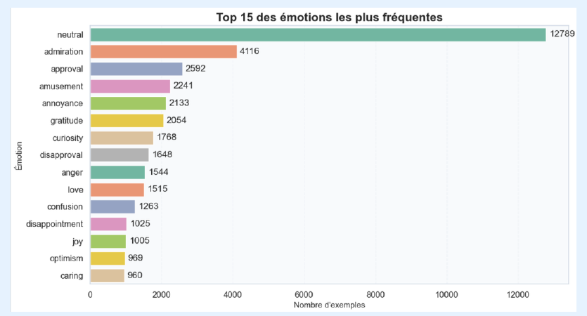
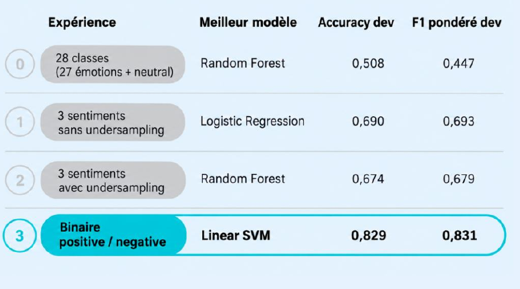
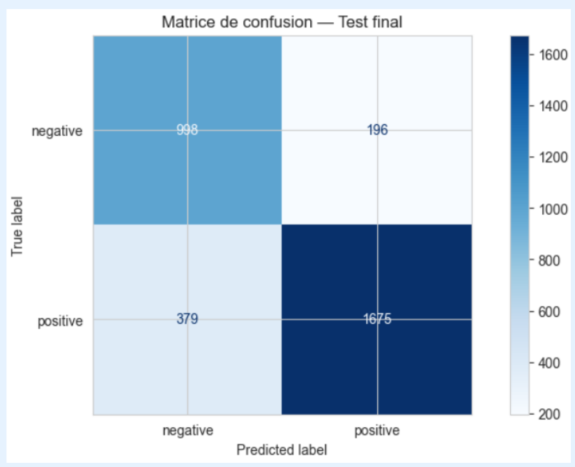

# GoEmotions — classification des émotions dans les textes

Mini-projet de traitement automatique du langage naturel (NLP) consacré à la classification de commentaires Reddit en anglais. Le projet compare plusieurs modèles classiques de machine learning à partir de représentations TF‑IDF et étudie trois niveaux de classification : 28 labels, trois sentiments, puis deux sentiments.

> **Objectif :** suivre l’effet du regroupement des émotions et de l’équilibrage du jeu d’entraînement sur les performances de classification.

[Ouvrir le notebook](notebooks/goemotions_progression.ipynb) · [Voir la présentation PowerPoint](presentation/Go_Emotions.pptx) · [Voir la présentation PDF](presentation/Go_Emotions.pdf)

## Résultats en bref

| Expérience | Meilleur modèle sur dev | Accuracy dev | F1 pondéré dev |
|---|---|---:|---:|
| 28 classes (27 émotions + neutral) | Random Forest | 0,508 | 0,447 |
| 3 sentiments, sans undersampling | Logistic Regression | 0,690 | 0,693 |
| 3 sentiments, avec undersampling | Random Forest | 0,674 | 0,679 |
| Binaire positive / negative | Linear SVM | **0,829** | **0,831** |

Le pipeline binaire Linear SVM, choisi sur `dev`, obtient **0,823 d’accuracy** et **0,825 de F1 pondéré** sur le jeu de test. Les scores entre expériences ne sont pas directement comparables, car leurs cibles n’ont pas le même nombre de classes.

## Visualisations

### Déséquilibre des émotions

`neutral` est nettement plus fréquent que les autres émotions dans le jeu d’entraînement. Cette distribution motive l’étude de stratégies de regroupement et d’équilibrage.



### Comparaison des expériences sur dev

Le regroupement en trois sentiments donne les meilleurs résultats de validation. L’undersampling équilibre le train, mais réduit légèrement les scores globaux sur dev. La tâche binaire obtient les scores les plus élevés, avec deux classes seulement.



### Évaluation finale sur test

Pour l’expérience binaire, l’ordre des classes de la matrice est `negative`, puis `positive` (lignes : vraies classes; colonnes : classes prédites). Le modèle prédit correctement 998 exemples négatifs et 1 675 exemples positifs.



## Méthode

- Les données GoEmotions sont initialement annotées en multi-label. Pour les expériences mono-label, le notebook conserve le premier label de chaque exemple.
- L’expérience fine conserve les 27 émotions et `neutral`, soit 28 classes.
- `data/sentiment_mapping.json` regroupe les labels en `positive`, `negative` et `neutral`. Ici, `neutral` comprend aussi `realization`, `surprise`, `curiosity` et `confusion`.
- L’undersampling s’applique uniquement aux données d’entraînement. Les distributions de `dev` et `test` restent inchangées.
- TF‑IDF est ajusté sur le train. Le modèle est sélectionné sur dev; le test sert à l’évaluation finale.
- Les modèles comparés sont Logistic Regression, Multinomial Naive Bayes, Linear SVM, Decision Tree et Random Forest.

## Données et provenance

Le dossier `data/` contient les splits GoEmotions, la liste des labels et le mapping des sentiments spécifique à ce projet. Les fichiers TSV n’ont pas d’en-tête. Les détails de provenance, d’attribution et de licence se trouvent dans [data/README.md](data/README.md) et [docs/SOURCES.md](docs/SOURCES.md).

## Installation et exécution

Prérequis : Python 3.10 ou plus récent.

```bash
python -m pip install -r requirements.txt
jupyter notebook
```

Depuis la racine du dépôt, ouvrir `notebooks/goemotions_progression.ipynb` et exécuter les cellules dans l’ordre. Le notebook résout les chemins des fichiers depuis le dépôt; il est donc recommandé de le lancer depuis la racine ou le dossier `notebooks/`. Les entraînements Random Forest peuvent prendre plusieurs minutes selon le matériel.

## Structure du dépôt

```text
.
├── assets/                 # Graphiques de la présentation intégrés à cette README
├── data/                   # Splits GoEmotions et mapping des labels
├── docs/                   # Sources, attribution et licence
├── notebooks/              # Notebook d’analyse et de modélisation
├── presentation/           # Présentations PDF et PowerPoint
├── README.md
└── requirements.txt
```

## Limites

Les commentaires sont en anglais et proviennent de Reddit. Le choix du premier label perd l’information secondaire des exemples multi-label. Le regroupement de quatre émotions dans `neutral` est une décision propre à ce projet. Les résultats dépendent de la cible retenue et ne mesurent pas les performances sur d’autres domaines ou langues.
