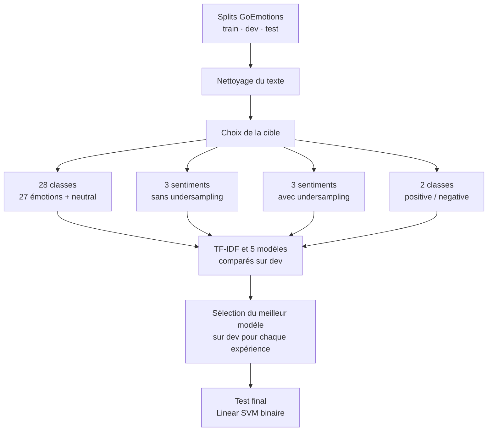

# 🌍 Analyse des émotions avec GoEmotions

[](https://www.python.org/) [](https://scikit-learn.org/) [](https://pandas.pydata.org/) [](https://jupyter.org/)

**Mini-projet de Machine Learning — année universitaire 2025/2026**

Ce projet étudie la classification d’émotions dans des commentaires Reddit en anglais à partir du jeu **GoEmotions**. Il compare des modèles classiques de machine learning avec une représentation **TF‑IDF**, puis observe l’effet de plusieurs regroupements de labels et de l’undersampling.

[📓 Ouvrir le notebook](notebooks/goemotions_progression.ipynb) · [📊 Présentation PowerPoint](presentation/Go_Emotions.pptx) · [📄 Présentation PDF](presentation/Go_Emotions.pdf)

## 📑 Sommaire

1. [Présentation du projet](#-présentation-du-projet)
2. [Résultats clés](#-résultats-clés)
3. [Jeu de données](#-jeu-de-données)
4. [Méthodologie](#-méthodologie)
5. [Résultats détaillés](#-résultats-détaillés)
6. [Limites et pistes d’amélioration](#️-limites-et-pistes-damélioration)
7. [Structure du dépôt](#-structure-du-dépôt)
8. [Installation et exécution](#-installation-et-exécution)
9. [Auteur](#-auteur)

## 🎯 Présentation du projet

La tâche originale GoEmotions est **multi-label** : un commentaire peut être associé à plusieurs émotions. Pour comparer les modèles classiques du projet, les expériences la transforment en classification mono-label en conservant le premier label de chaque exemple.

| Axe | Cible | Objectif | Stratégie |
|---|---|---|---|
| Classification fine | 27 émotions + `neutral` (28 classes) | Identifier une émotion précise | Premier label de l’exemple |
| Classification par sentiment | `positive`, `negative`, `neutral` | Regrouper les émotions en trois catégories | Avec et sans undersampling |
| Classification binaire | `positive`, `negative` | Comparer les deux sentiments polaires | Retrait de `neutral` et undersampling du train |

L’objectif est de mesurer les performances sur `dev`, de sélectionner le meilleur modèle pour chaque expérience, puis de réserver `test` à l’évaluation finale du pipeline binaire.

## 🏆 Résultats clés

| Expérience | Meilleur modèle sur dev | Accuracy dev | F1 pondéré dev |
|---|---|---:|---:|
| 28 classes (27 émotions + neutral) | Random Forest | 0,508 | 0,447 |
| 3 sentiments, sans undersampling | Logistic Regression | 0,690 | 0,693 |
| 3 sentiments, avec undersampling | Random Forest | 0,674 | 0,679 |
| Binaire `positive` / `negative` | Linear SVM | **0,829** | **0,831** |

Le **Linear SVM** binaire, sélectionné sur `dev`, atteint **0,823 d’accuracy** et **0,825 de F1 pondéré** sur `test`. Les expériences n’ont pas la même cible ni le même nombre de classes : leurs scores ne sont donc pas directement comparables.

## 📊 Jeu de données

Les fichiers `train.tsv`, `dev.tsv` et `test.tsv` sont des splits GoEmotions sans ligne d’en-tête.

| Propriété | Description |
|---|---|
| Langue et origine | Commentaires Reddit en anglais |
| Labels d’origine | 27 émotions, auxquels s’ajoute `neutral` |
| Train | 43 410 exemples |
| Dev | 5 426 exemples |
| Test | 5 427 exemples |
| Mapping du projet | `data/sentiment_mapping.json` |

Le déséquilibre des classes est visible dans les données : `neutral` apparaît beaucoup plus souvent que les autres émotions.


La provenance, l’attribution, la licence et la structure des fichiers sont détaillées dans [data/README.md](data/README.md) et [docs/SOURCES.md](docs/SOURCES.md).

## 🔬 Méthodologie

Le pipeline suit les mêmes étapes pour chaque expérience, en adaptant la cible aux trois niveaux de classification.



| Étape | Traitement | Rôle |
|---|---|---|
| Prétraitement | Minuscules, suppression des URLs, mentions, chiffres et ponctuation | Réduire les variations de forme dans les commentaires |
| Labels | Premier label conservé pour chaque exemple | Transformer la cible multi-label en mono-label |
| Mapping | Regroupement en 3 sentiments, puis en 2 classes pour l’expérience binaire | Comparer des granularités de classification différentes |
| Équilibrage | Undersampling du train uniquement | Réduire la domination des classes majoritaires sans modifier `dev` ni `test` |
| Vectorisation | TF‑IDF ajusté sur le train | Convertir les commentaires en caractéristiques numériques |
| Sélection | Comparaison de 5 modèles sur `dev` | Choisir le meilleur pipeline avant l’évaluation finale |

**Modèles comparés :** Logistic Regression, Multinomial Naive Bayes, Linear SVM, Decision Tree et Random Forest.

Dans le mapping utilisé, `neutral` comprend le label `neutral` ainsi que `realization`, `surprise`, `curiosity` et `confusion`. Les détails sont dans [`data/sentiment_mapping.json`](data/sentiment_mapping.json).

## 📈 Résultats détaillés

### Comparaison sur dev

Pour l’expérience à trois sentiments, Logistic Regression obtient une accuracy de 0,690 et un F1 pondéré de 0,693 sur dev. Après undersampling, ces scores passent à 0,674 et 0,679. Le train équilibré contient **9 150 exemples par sentiment** selon les sorties du notebook. La classification binaire obtient les scores les plus élevés, avec deux classes.


### Évaluation finale — test binaire

Le Linear SVM a été choisi sur `dev`; le jeu `test` sert à l’évaluation finale. Les lignes de la matrice représentent les vraies classes et les colonnes les prédictions, dans l’ordre `negative`, puis `positive`.

| Classe réelle | Prédit `negative` | Prédit `positive` |
|---|---:|---:|
| `negative` | 998 | 196 |
| `positive` | 379 | 1 675 |


| Métrique sur test | Score |
|---|---:|
| Accuracy | 0,823 |
| F1 pondéré | 0,825 |

### Lecture des résultats

- La tâche à 28 classes est plus difficile : plusieurs émotions sont proches sur le plan sémantique.
- L’undersampling équilibre l’entraînement, mais ne garantit pas une hausse des scores globaux.
- La classification binaire est plus simple que la classification fine; son score ne doit pas être présenté comme directement supérieur à celui des tâches à 28 ou 3 classes.

## ⚠️ Limites et pistes d’amélioration

### Limites

- Le choix du premier label écarte les autres annotations des commentaires multi-label.
- Le regroupement de `realization`, `surprise`, `curiosity` et `confusion` dans `neutral` est une décision propre à ce projet.
- Les commentaires sont en anglais et proviennent de Reddit; les résultats ne garantissent pas les mêmes performances sur d’autres domaines ou langues.
- L’undersampling supprime des exemples majoritaires du train et peut réduire l’information disponible pour l’apprentissage.

### Pistes d’amélioration

- Conserver la nature multi-label du jeu et comparer des méthodes de classification multi-label.
- Tester des modèles de langue pré-entraînés en anglais et comparer leur coût à celui des modèles classiques.
- Évaluer d’autres stratégies pour les classes déséquilibrées, sans modifier la distribution de `dev` et `test`.
- Valider le pipeline sur des textes issus d’une autre source afin d’évaluer sa généralisation.

## 📂 Structure du dépôt

```text
.
├── assets/                 # Graphiques intégrés à la README
├── data/                   # Splits, labels et mapping des sentiments
├── docs/                   # Sources, attribution et licence
├── notebooks/              # Notebook d’analyse et de modélisation
├── presentation/           # Présentations PDF et PowerPoint
├── README.md
└── requirements.txt
```

## 🚀 Installation et exécution

**Prérequis :** Python 3.10 ou plus récent.

```bash
git clone https://github.com/sarahaskri/Go_emotions.git
cd Go_emotions
python -m venv .venv
```

Activer l’environnement virtuel :

```powershell
# Windows PowerShell
.venv\Scripts\Activate.ps1
```

```bash
# macOS / Linux
source .venv/bin/activate
```

Installer les dépendances et lancer Jupyter depuis la racine du dépôt :

```bash
python -m pip install -r requirements.txt
jupyter notebook
```

<div align="center">
<sub>Si ce projet vous est utile, n'hésitez pas à lui laisser une ⭐</sub>
</div>
Ouvrir ensuite `notebooks/goemotions_progression.ipynb` et exécuter les cellules dans l’ordre. Le notebook retrouve les fichiers depuis le dossier `data/`. Les entraînements Random Forest peuvent prendre plusieurs minutes selon le matériel.

## 👩‍💻 Auteur

**Sarra Askri** — Mini-projet de Machine Learning, année universitaire 2025/2026.
